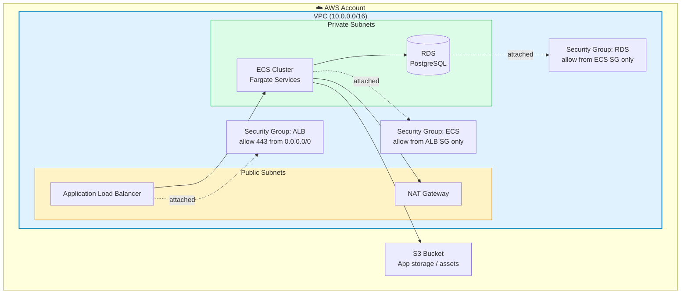
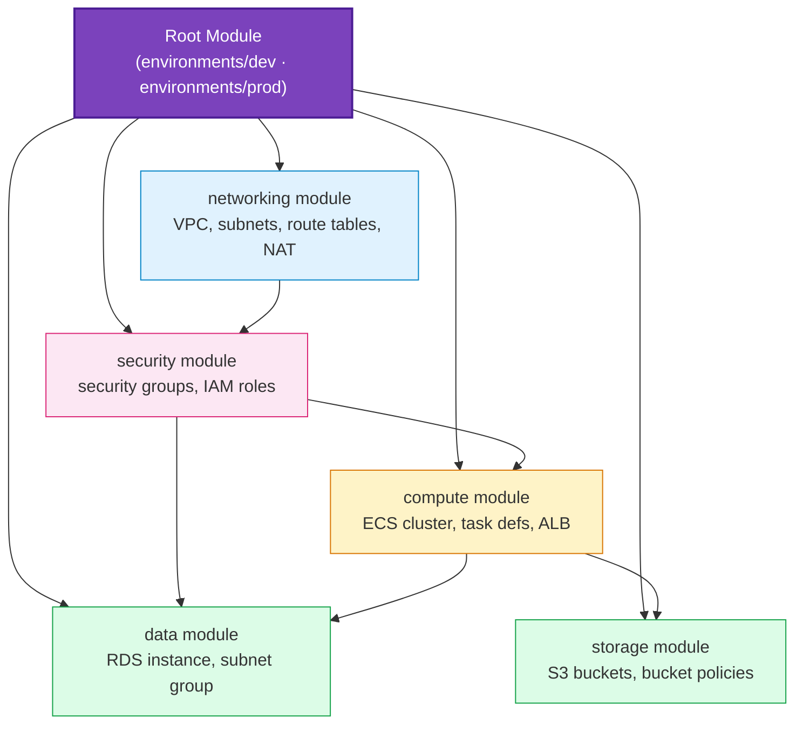
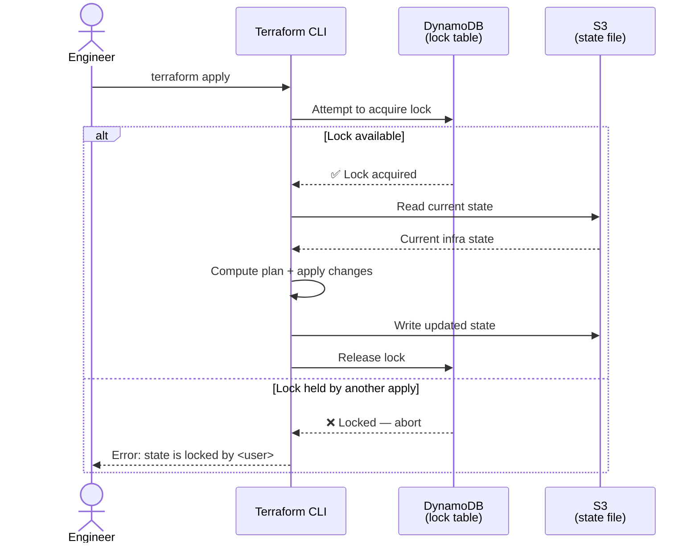
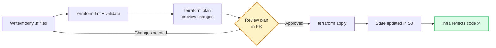
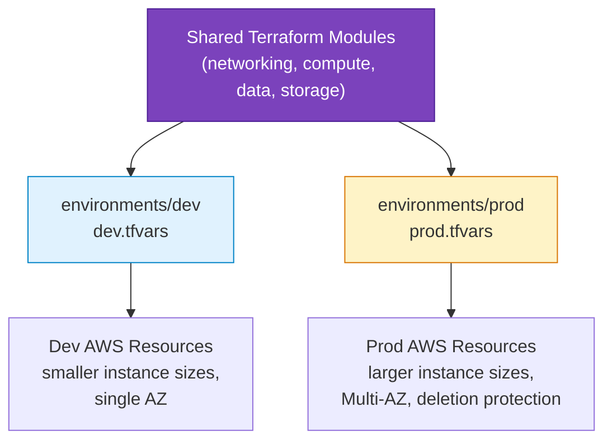

<div align="center">

# 🧱 InfraKit

### Infrastructure as Code with Terraform

*AWS infrastructure, fully codified — reproducible, version-controlled, and team-safe.*

[](#)
[](#)
[](#)
[](#)
[](#license)

</div>

---

## 🧭 Table of Contents

- [Overview](#-overview)
- [Key Features](#-key-features)
- [Infrastructure Architecture](#-infrastructure-architecture)
- [Terraform Module Structure](#-terraform-module-structure)
- [Remote State & Locking](#-remote-state--locking)
- [Apply Workflow](#-apply-workflow)
- [Environment Strategy](#-environment-strategy)
- [Tech Stack](#-tech-stack)
- [Project Structure](#-project-structure)
- [Getting Started](#-getting-started)
- [Configuration](#-configuration)
- [State Management Commands](#-state-management-commands)
- [Roadmap](#-roadmap)
- [License](#-license)

---

## 🔍 Overview

**InfraKit** is a fully codified AWS infrastructure setup — every resource (VPC, subnets, security groups, ECS cluster, RDS, S3) is defined as **Terraform modules** instead of being clicked together in the AWS Console. The entire environment can be destroyed and recreated from scratch, reviewed via pull request before it's ever applied, and safely shared across a team through remote state with locking.

The project's focus is on **infrastructure discipline**: no manual console changes, no configuration drift, and no two engineers stepping on each other's `terraform apply` at the same time.

> **Built for:** demonstrating production-grade IaC practices — modular Terraform, remote state, locking, and clean environment separation — the foundation any cloud deployment (like CloudLedger) is meant to sit on top of.

---

## ✨ Key Features

| Feature | Description |
|---|---|
| 🧩 **Modular Terraform** | Infrastructure split into reusable modules (networking, compute, data, storage) |
| ☁️ **Full AWS Footprint** | VPC, subnets, security groups, ECS cluster, RDS, and S3 — all codified |
| 🔒 **Remote State** | Terraform state stored centrally in S3, not on any one engineer's laptop |
| 🔐 **State Locking** | DynamoDB table prevents concurrent `apply` operations from corrupting state |
| 🌎 **Multi-Environment** | Separate `.tfvars` files for `dev` and `prod` from the same module code |
| ♻️ **Reproducible** | Entire environment can be destroyed and rebuilt identically from code |
| 📝 **Plan-Before-Apply** | Every change is previewed via `terraform plan` before touching real infrastructure |

---

## 🏗️ Infrastructure Architecture

The resources Terraform provisions, and how they relate to each other inside AWS:



**Design principles:**
- **Network isolation** — only the ALB sits in public subnets; ECS and RDS live in private subnets with no direct internet exposure.
- **Security groups as a chain of trust** — RDS only accepts traffic from the ECS security group, ECS only accepts traffic from the ALB security group. No wide-open ports.
- **Everything reproducible** — this entire diagram is generated from `terraform apply`, not manual console clicks.

---

## 🧩 Terraform Module Structure

Infrastructure is split into composable modules, each owning one concern:



Each module exposes clean `variables.tf` inputs and `outputs.tf` values — for example, the `networking` module outputs subnet IDs that the `compute` and `data` modules consume, keeping dependencies explicit rather than hardcoded.

---

## 🔒 Remote State & Locking

Terraform state is never stored locally — it lives in S3, with DynamoDB coordinating who's allowed to write to it at any given moment.



- **S3 backend** — the `.tfstate` file is stored centrally and versioned, so every engineer sees the same source of truth and can recover a previous state if needed.
- **DynamoDB locking** — before any `apply`, Terraform writes a lock record; a second concurrent `apply` is blocked until the first finishes, preventing two engineers from corrupting state simultaneously.

---

## ⚙️ Apply Workflow



No infrastructure change reaches AWS without first being previewed via `plan` and reviewed — the applied state is always traceable back to a specific commit.

---

## 🌎 Environment Strategy



Both environments run the **exact same module code** — the only differences are the input values in each `.tfvars` file (instance sizes, replica counts, deletion protection flags). This guarantees dev and prod never drift architecturally, only in scale.

---

## 🧰 Tech Stack

| Layer | Technology | Purpose |
|---|---|---|
| **IaC Tool** | Terraform | Declarative infrastructure provisioning |
| **Cloud Provider** | AWS | Target platform for all provisioned resources |
| **Remote State** | AWS S3 | Centralized, versioned Terraform state storage |
| **State Locking** | AWS DynamoDB | Prevents concurrent state writes |
| **Networking** | AWS VPC, Subnets, NAT Gateway | Network isolation and routing |
| **Compute** | AWS ECS | Container orchestration target |
| **Database** | AWS RDS | Managed relational database |
| **Storage** | AWS S3 | Application-level object storage |

---

## 📁 Project Structure

```
InfraKit/
├── modules/
│   ├── networking/     # VPC, public/private subnets, IGW, optional NAT
│   ├── security/       # ALB/ECS/RDS SGs + ECS IAM roles
│   ├── ecs_alb/        # ECS Fargate cluster, service, ALB
│   ├── rds/            # PostgreSQL + subnet group
│   └── s3/             # App bucket (encryption, versioning, lifecycle)
├── environments/
│   ├── dev/            # Module wiring + example tfvars / backend configs
│   └── prod/           # Same modules; prod-sized defaults + Multi-AZ
├── bootstrap/
│   └── state-backend/  # S3 + DynamoDB for remote state (documented; apply once)
├── .github/workflows/
│   └── terraform.yml   # fmt + validate on PRs
├── .terraform-version
├── NOTES-RESUME-PROJECTS.md
├── TODO.md
└── README.md
```


---

## 🚀 Getting Started

### Prerequisites
- Terraform ≥ 1.5
- AWS CLI configured with appropriate credentials
- An AWS account with permissions to create VPC/ECS/RDS/S3/DynamoDB resources

### 1. Bootstrap the remote state backend (one-time, optional until you apply)

See [`bootstrap/README.md`](bootstrap/README.md). Creates S3 (versioned, encrypted, blocked public) + DynamoDB lock table. Demo clones can skip apply and keep local state.

### 2. Initialize and validate / plan dev

```bash
cd environments/dev
cp dev.tfvars.example terraform.tfvars   # edit db_password
terraform init
terraform fmt -recursive ../..
terraform validate
terraform plan -var-file=terraform.tfvars   # needs AWS credentials
```

### 3. Wire remote state (after bootstrap)

```bash
cp backend.tf.example backend.tf
cp backend.hcl.example backend.hcl           # fill from bootstrap outputs
terraform init -backend-config=backend.hcl -migrate-state
```

Prod uses the same modules under `environments/prod` — copy `prod.tfvars.example`, require a reviewed plan, then apply.

---

## ⚙️ Configuration

| Variable | Description |
|---|---|
| `environment` | `dev` or `prod` — used for resource naming/tagging |
| `vpc_cidr` | CIDR block for the VPC |
| `az_count` | Number of Availability Zones to spread subnets across |
| `db_instance_class` | RDS instance size (e.g. `db.t3.micro` for dev, `db.r6g.large` for prod) |
| `ecs_desired_count` | Desired number of ECS tasks |
| `enable_deletion_protection` | `true` in prod, `false` in dev |

---

## 🗄️ State Management Commands

| Command | Purpose |
|---|---|
| `terraform state list` | List all resources tracked in the current state |
| `terraform state show <resource>` | Inspect a specific resource's current state |
| `terraform force-unlock <lock-id>` | Manually release a stuck DynamoDB lock (use with caution) |
| `terraform plan -var-file="dev.tfvars"` | Preview changes for the dev environment |
| `terraform workspace list` | List available workspaces (if using workspaces instead of directories) |

---

## 🗺️ Roadmap

- [ ] Add Terraform Cloud/Atlantis for automated plan-on-PR
- [ ] Add `terraform-compliance` or `checkov` for policy-as-code scanning
- [ ] Add a `staging` environment between dev and prod
- [ ] Migrate hardcoded values to a central `tfvars` schema with validation
- [ ] Add cost estimation via `infracost` in CI
- [ ] Add module versioning + a private Terraform module registry

---

## 📄 License

Distributed under the MIT License. See `LICENSE` for more information.

<div align="center">

**InfraKit** — built with Terraform, AWS, S3 & DynamoDB

</div>
